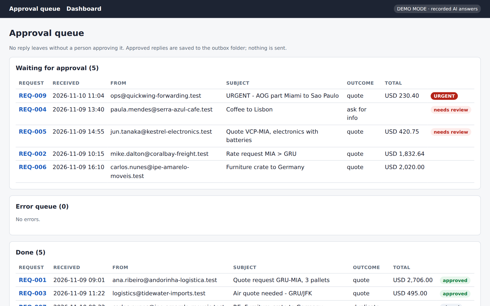
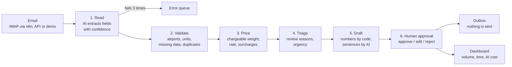
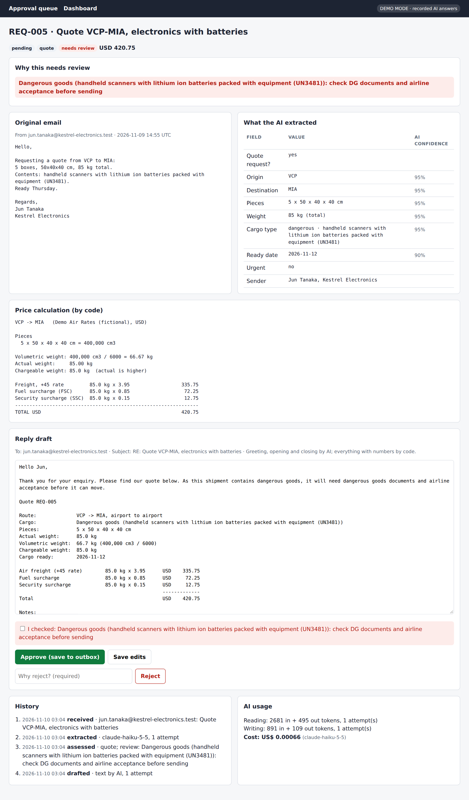
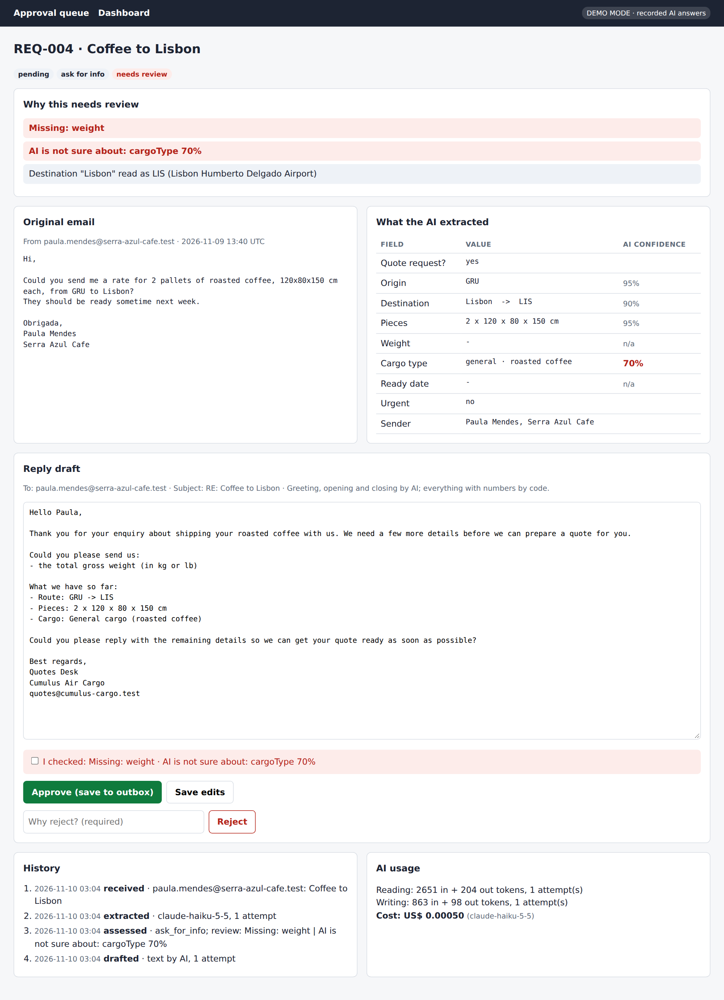
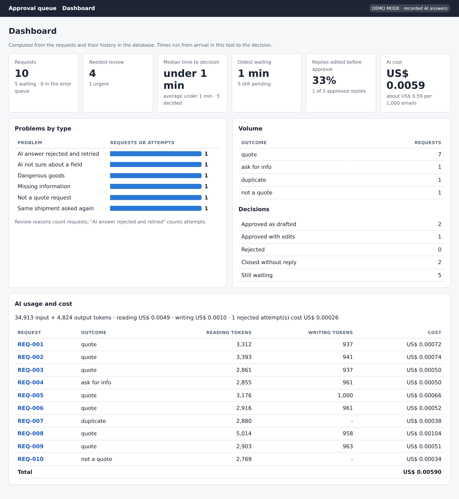
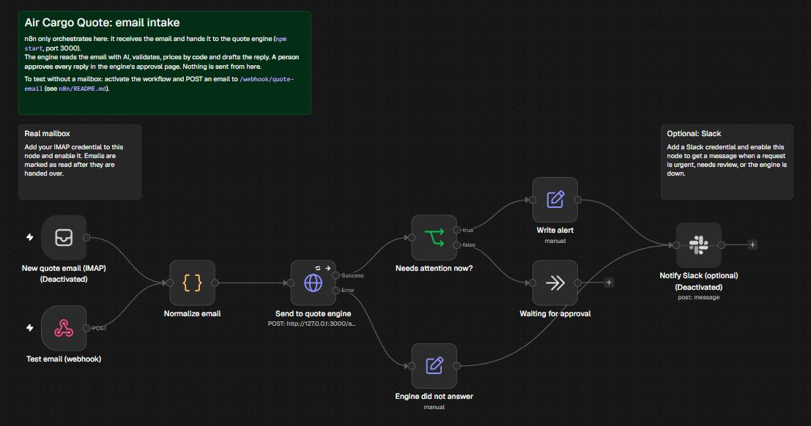
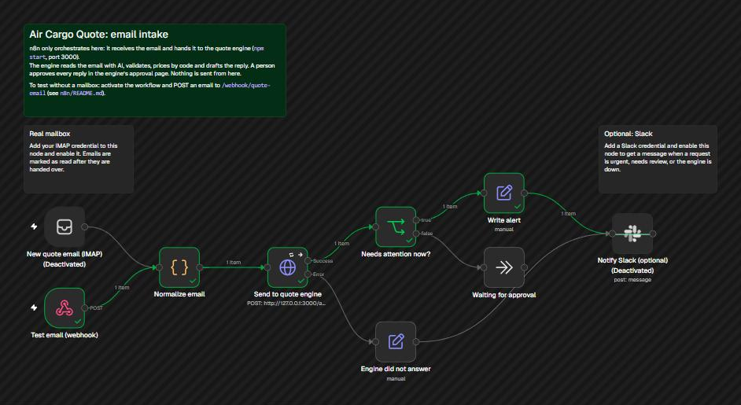

# Air Cargo Quote Assistant

Freight forwarders still answer air cargo quote requests by hand: read the email, work out the chargeable weight, look up the rate, type the reply. This assistant does the reading and the arithmetic and leaves a reply draft for a person to approve.

[](https://github.com/leofreitas-dev/air-cargo-quote-assistant/actions/workflows/ci.yml) [](LICENSE) [](https://nodejs.org)

- **AI reads** the email (any wording, cm or inches, kg or lb) and **writes** the friendly sentences of the reply.
- **Code computes** every number: chargeable weight, weight break, surcharges, total. Covered by tests.
- **A person approves** every reply. Dangerous goods, missing data and low AI confidence always go to review, with the reason on screen.

Runs without an API key: demo mode replays recorded answers from the real AI.



*The urgent request is listed first, then the two held for review. One of them has no total: its weight is missing. Approved and closed requests are listed under Done.*

## Try it in two minutes

Requires Node 24 or later. No API key, no database server, no n8n needed.

```
npm install
npm start          # approval tool at http://127.0.0.1:3000, dashboard at /dashboard
```

Or in the terminal, without a browser:

```
npm run demo                 # the 10 demo emails, end to end
npm run demo -- --drafts     # plus the full reply draft for each email
npm test                     # 139 tests
```

## How it works



Steps 2 to 4 are plain TypeScript with no AI involved. The AI never sees or writes a price: the price block of the reply is built by code, and the AI's sentences are rejected if they contain any digit.

## What the reviewer sees

A request with dangerous goods: the reason for review at the top, the original email next to what the AI extracted (with its confidence per field), the price calculation step by step, and the draft. Approving requires ticking "I checked".



*The review reason at the top, the AI's confidence for each field, the chargeable weight (85 kg: the actual weight is higher than the volumetric one), and the "I checked" box that approval requires.*

## Every error path has an exit

| Situation | What happens |
|---|---|
| A required field is missing (e.g. no weight) | No price is guessed. The draft asks the customer for exactly what is missing. |
| Dangerous goods (lithium batteries, UN numbers) | Quoted, but held for review: DG documents and airline acceptance must be checked. |
| AI unsure about a field (confidence below 80%) | Held for review, with the field and the percentage shown. |
| Unknown airport code (`XXX`) | Flagged; the draft asks for the correct airport. |
| City with several cargo airports ("New York": JFK or EWR) | Not guessed; the draft asks which one. |
| City with one main cargo airport ("Sao Paulo") | GRU is assumed, and the draft says so: "if the cargo ships from Viracopos (VCP), let us know". |
| The same shipment asked again within 7 days | Detected as a duplicate; no second quote. |
| The same email delivered twice | Recognised by its Message-ID; no second request, no second AI charge. |
| AI answer invalid or cut off | Retried up to 3 times, then the request goes to the error queue with a Retry button. |
| AI fails while writing the reply | A standard template is used; the price and the questions are unaffected. |
| Not a quote request (a payment confirmation) | No draft; a person decides. |



*No weight in the email, so no price. The draft asks for the gross weight and lists what is already known. The cargo type is flagged at 70% confidence.*

## Pricing

Fictional rates for 8 routes in `data/tariffs.json`. The rules are the standard ones in the trade:

- **Chargeable weight** = the greater of actual weight and volumetric weight (cm³ / 6000), rounded up to the next 0.5 kg.
- **Weight breaks** (N, +45, +100, +300, +500 kg). If a higher break costs less in total, the higher break is used.
- **Minimum charge** per route.
- **Fuel and security surcharges** per chargeable kg.
- **Money in integer cents**, so `10.5 kg x 0.85` is exactly 8.93, not 8.92.

```
npm run price -- GRU MIA 3x120x100x110cm 420kg   # the calculation, step by step
npm run airport -- "Sao Paulo Guarulhos" XXX     # how an airport written in an email is read
```

## Dashboard and AI cost

Volume, problems by type, time to decision, the share of replies edited before approval, and the AI tokens and cost of every request.

The AI is Claude Haiku (the cheapest model that does the job). Reading and drafting the 10 demo emails cost US$ 0.0059 in total: **about US$ 0.59 per 1,000 emails**.



*The demo after 5 decisions: 4 of 10 requests needed review, 1 of 3 approved replies was edited, and the AI cost is shown per request (US$ 0.0059 for all 10).*

## n8n integration

For a client who already runs n8n, `n8n/quote-intake.workflow.json` watches the mailbox (IMAP), hands each email to the engine's API and posts an alert (Slack, optional) when a request is urgent, needs review or lands in the error queue. n8n only orchestrates; all logic stays in the engine, so there is one copy of it. Details in [n8n/README.md](n8n/README.md).



*Two triggers (IMAP, off in the export, and a test webhook) feed one call to the engine. The error branch handles an engine that does not answer.*



*A test email the demo has no recorded AI answer for: the engine put it in the error queue, so n8n took the alert branch. (Slack is off in the export.)*

## Live mode (real AI)

```
cp .env.example .env         # then put your Anthropic API key in .env
npm start -- --live          # new emails are read by the real AI (paste form at /new, or the API)
npm run demo -- --live       # the 10 demo emails through the real AI
```

Live mode uses its own database and outbox, separate from the demo.

## Project layout

```
src/pricing      chargeable weight, weight breaks, surcharges, money in cents
src/validation   airports, required fields, duplicates, review rules
src/extraction   AI reading: prompt, schema check, retries
src/drafting     reply drafts: price block by code, sentences by AI, template fallback
src/pipeline     one email from start to finish
src/app          approve / edit / reject, outbox, dashboard metrics
src/web          approval tool, dashboard and JSON API (node:http, no framework)
src/store        SQLite (node:sqlite, built into Node)
data/            fictional rates, airports, demo emails, recorded AI answers
n8n/             n8n workflow and its notes
test/            Vitest
```

## Notes

- All emails, companies and people are fictional (`.test` domains). All rates are fictional. `data/airports.json` is a demo subset of real airports (public IATA data).
- Nothing is ever emailed: approving a reply writes it to `outbox/`.
- The approval tool listens on 127.0.0.1 only and has no login. It is a local demo, not a hosted product.

## About

Built by Leonardo Freitas. I build AI automations that don't break: quote desks, lead intake, n8n workflows, self-hosted or cloud.

If your team still answers quote requests or leads by hand from the inbox, get in touch.

- Book a 20-min intro call: https://cal.com/leofreitas-dev/intro
- Email: leonardofreitasdev06@gmail.com
- GitHub: https://github.com/leofreitas-dev

Built with AI agents (Claude Code) under my direction.

## License

MIT. See [LICENSE](LICENSE).
